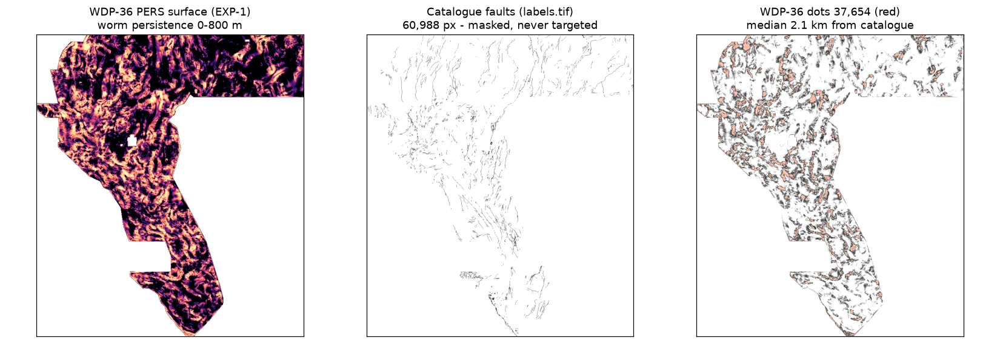

# WDP-36 Monograph — Worm Depth-Persistence Buried-Fault Lane (2026-10-26)

Branch `arena/b8f55e32-gemsdoe36`. Labels on every number: **HOLDOUT-DTI** (local hide-and-recover,
evaluator + withheld count + 95% CI) or **ORGANIZER-CONFIRMED** (portal receipt via owner brief).
Executable artifacts: `src/gemsdoe36/wdp_features.py`, `scripts/run_wdp36.py`,
`tests/test_wdp36.py`; lock `evidence/wdp36_preregistration_20261026.json`
(SHA-256 `860f7a3565735ae7837aa62a48c5457fc2ab9398e066c89b8f564409b659076f`, verified by the
pipeline before any computation); results `evidence/wdp36_run_card_20261026.json`,
`evidence/wdp36_holdout_experiments_20261026.json`, `evidence/wdp36_crosscheck_20261026.json`.

## 1. Executive summary — which focus-site submission is “best”, and what is safe to submit?

| Question | Answer (provenance-labelled) |
|---|---|
| Highest historical score among the 9 focus sites? | **GEMSDOE32 `h33-h33-2-b2`: 0.2778 ORGANIZER-CONFIRMED** (37,654 dots). It is *already submitted and scored*; re-uploading identical bytes is a duplicate, explicitly forbidden by this session's brief. |
| Runner-up already scored? | GEMSDOE36 legacy `pinn-38854`: 0.2750 ORGANIZER-CONFIRMED — measured in-repo as GEMSDOE32's dots + 1,200 extra dots (96.91% overlap); resubmission would be a near-copy. |
| Any *unsubmitted* file across GEMSDOE24/25/27/28/30/31/32/33/36 that has cleared a buffered holdout + uniqueness + format gate? | **None found.** Every recent zero-copy candidate in the 9 repos is either already ORGANIZER-CONFIRMED at ≤0.2190 (GEMSDOE27 H29-S 0.2190; halo-collapses 0.0217–0.1462) or fail-closed DO NOT SUBMIT by its own repo gate. |
| This branch's new unique file? | `gemsdoe36-wdp36-exp1-20261026-zeros.tif` (SHA-256 `ae9da29e45c67d03b7a7fd438a3cf0686f0678111181cd960b86dffb56f0f698`): **DOWNLOAD: YES · DO NOT SUBMIT — hold weekly slot**. HOLDOUT-DTI 0.093269 (below promotion bars) + one dense-blanket literal-overlap failure; format/canary/focus-uniqueness pass. |
| Public leaderboard context | 0.4413 (external #1, read 2026-10-25 in-repo) — **not** a focus-site score. The brief's “0.3195 highest” is stale. No focus-site method is close; closing the gap needs +59% credit-per-dot, i.e. a better detector, not emission tuning. |

**Safest live-slot decision today: submit nothing.** Spending one of three weekly slots on any
existing unsubmitted focus-site file contradicts Maximize P(Win): none has beaten the shared
holdout best. The selector step (separate, human, weekly-cap aware) should wait for a lane that
clears G2, or explicitly accept Final-Round expanded-label speculation with eyes open (see §5).

## 2. Why did GEMSDOE32 reach 0.2778 — and can persistence beat it? (condensed; full proof in `why-02778.md`)

The metric (official page 967, re-fetched 2026-10-26) is DTI = TPw/(TPw+0.2·FPw+0.8·FNw) with a
300 m triangular kernel; binary dots are optimal by linear-fractional algebra. Measured anatomy:
0.2600 `d2.8` (44,090) → 0.2708 `solo` (40,199, drop ≤1 px collar) → **0.2778 `b2` (37,654, drop
≤2 px collar, 0 XOR)**. Removed collar dots carried 0.002–0.006 credit vs 0.130 average — test
faults are *new* faults absent from the USGS database and known-fault vicinities earn ~nothing, so
collar dots were pure 0.2·FP tax. **0.2778 is denominator thrift on the best inherited field, not
new geology.** At equal budget, 0.30 needs ≈+8% TPw, 0.3195 ≈+15%, 0.4413 ≈+59%.

WDP-36 asked whether *deep/buried* geography — invisible to the scarp/LiDAR lanes that dominate
this repo (ATVR-36/H36-CTRB/H36-GPS) — supplies that credit. Answer on the only honest yardstick
available (catalogue hide-and-recover): **no, not yet** (0.0933 HOLDOUT-DTI; §4). The detector is
real (canary-clean, fold-balanced, visually worm-following) but recovers hidden *catalogue-style*
faults worse than supervised multi-sensor lanes (0.1144–0.1320). Whether its basin-interior dots
(2.1 km median from catalogue) hit *expert* new faults at a higher rate than holdout suggests
cannot be known without spending a slot — and the preregistered gate forbids spending it on this
evidence. Both statements are kept; neither is inflated into a projection.

## 3. Method (exactly as preregistered; no post-hoc tuning)

Unsupervised, zero catalogue-trained parameters (catalogue used only for holdout truth/visible
masking and the d>2 px exclusion). TMI (band 14) + isostatic gravity (band 13): median fill →
rFFT upward continuation h∈{0,200,400,800} m → spectral THDR → footprint percentile ranks →
geometric-mean persistence → rank fusion = PERS. EXP-2 adds strain gradient ridges (04/07/08,
0.30 weight); EXP-3 adds seismic composite (16/−10, weights 0.60/0.25/0.15). Control A0 =
h=0-only worms. Emission: shared 300 m CELF submodular cover, 37,654 dots. Holdout: shared
`SegmentHoldout` (`gems-segment-pooled-v1`, 1.5 km buffer, whole components, pooled DTI).
Excluded bands 06/11/18 (mislabelled/signed per IR-36-ATVR-02/03) and all topo/LiDAR/hydrothermal
channels by lane design. Deferred (sandbox-unobtainable, `curl 000` measured): ASF OPERA DISP-S1
InSAR; GeoDAWN 1-D flight-line CSVs (DOI 10.5066/P93LGLVQ, CC0).

## 4. Results — all HOLDOUT-DTI, `gems-segment-pooled-v1`, 60,988 withheld px, 3,199 components

| Arm | Pooled DTI [95% CI] | NW | NE_LidarGapHeavy | SW | SE |
|---|---|---|---|---|---|
| A0 single-scale | 0.091901 [0.081491, 0.101408] | 0.082054 | 0.079970 | 0.093605 | 0.105006 |
| **EXP-1 PERS (winner)** | **0.093269 [0.083380, 0.103501]** | 0.090245 | 0.083541 | 0.088357 | 0.108190 |
| EXP-2 +strain | 0.091090 [0.081887, 0.100339] | 0.089508 | 0.079795 | 0.086296 | 0.106174 |
| EXP-3 +strain+seis | 0.093156 [0.083076, 0.103199] | 0.089648 | 0.082633 | 0.085536 | 0.112109 |

- Paired EXP-1 − A0 = **+0.001368 [−0.004578, +0.006991]**, 3/4 folds, CI includes 0 → persistence
  is *not* significantly better than single-scale worms at recovering catalogue faults. The core
  hypothesis is therefore **unsupported on this yardstick** (not disproven for blind faults —
  see holdout limitation locked in advance).
- Strain ridges **hurt** (EXP-2 < EXP-1 in pooled and 3/4 folds): smooth geodetic gradients do not
  localise 100 m fault traces in this encoding. Seismic add-on is neutral pooled, best in SE.
- Leakage canary: 8/8 pass, max two-polarity AUC **0.6145** (`seis`, SE fold); pooled AUCs
  0.517–0.566. No leakage; genuinely weak-but-real signals.
- Uniqueness: surface max |ρ| **0.264** (198 rasters) PASS; focus-9 dot overlap max **0.4909**,
  vs champion B2 **0.2360** (ρ 0.0177), vs local lanes 0.166–0.280 — a genuinely distinct lane.
  Literal expanded gate FAILS on exactly one competing-classified blanket
  (GEMSDOE67 `ovtr-ml-cover`, overlap 0.7227, 54.8% 3-px footprint coverage; ρ 0.040) plus three
  space-filling controls (73–100% coverage). Dots were **not** perturbed to evade; fail-closed.
- Format: strict whole-array [0,1] PASS (12,279,160/12,279,160 finite), EPSG:32611 3730×3292
  float32 nodata=None, 37,654 dots, 0 within 2 px, median d_cat 21.1 px, spacing min 2.0 px,
  4.47% of dots within 5 px of footprint boundary (no boundary-frame artefact).
- Budget: 3/3 experiments, 543.9 s pipeline walltime (plus data/registry restore).

**Portal “[0, 1]” diagnosis (measured on all 10 existing downloads):** every `-zeros.tif` passes
strict whole-array [0,1]; every `-nan.tif` twin fails the strict test (7,111,787 NaNs outside the
footprint) although footprint-aware checks pass; `GEMS36_FORMAT_TEST_NOT_SUBMISSION.tif` is a
32×48 fixture. WDP-36 therefore ships **zeros-only** as “File to submit” (zeros files hold
ORGANIZER-CONFIRMED scores 0.2778/0.2750, proving portal acceptance), and the site quarantines
nan twins as DO-NOT-UPLOAD GIS companions.

## 5. Limitations, irregularities, and what would actually raise P(Win)

1. **Holdout bias (locked in advance):** hide-and-recover rewards catalogue-like faults. A buried-
   fault lane may be undervalued. Remedy is *not* gate override; it is a better validation target
   (e.g. expert-style blind mapping sample, or Final-Round-aware selector accepting speculation
   explicitly). Until then, negative stands.
2. **Persistence ≈ single-scale** for recovery: upward continuation to 800 m on 100 m grids
   mostly re-ranks the same worms. Raw flight-line profiles (H-FLIGHTLINE, deferred) are the
   physically sharper version; needs an unrestricted download + SHA-pinned GitHub mirror.
3. **Supervised lanes still lead holdout** (0.114–0.132) but also fail promotion bars (0.13375 /
   0.14876). The repo's best next step remains the ATVR+CTRB out-of-fold ensemble (37% mutual
   overlap, complementary folds) — now with WDP-36 as a third decorrelated member (≤28% overlap
   with each local lane) *if* a future preregistered ensemble lane beats the bar on the same
   evaluator. Ensembling without that preregistration would be lane drift; not done here.
4. **Data provenance:** competition rasters come from a SHA-pinned GitHub mirror (DrivenData data
   tab is login-walled; sandbox cannot reach it). Integrity-pinned ≠ organizer-authenticated.
   Template contains 60,988 ones (= labels), contradicting page-967 “total fault absence” text —
   use template as grid/footprint only (already logged; re-verified 2026-10-26).
5. **No GPU, 3.8 GB RAM sandbox:** 1 m DEM expert-scale scarp modelling (the `why-02778.md`
   favoured route to +8% TPw) remains out of reach here; it needs CI/unrestricted compute.

**Selector guidance:** if a slot *must* be spent for information value, that is a human decision
outside this lane's gate; the least-bad speculative candidate by holdout is H36-GPS (0.13203) —
still negative — while WDP-36 maximises *new-geography* information (lowest overlaps, farthest
from catalogue). This monograph recommends holding all slots until a preregistered ensemble or
1 m-DEM lane clears G2. Negative results are deliverables; this lane is one.
